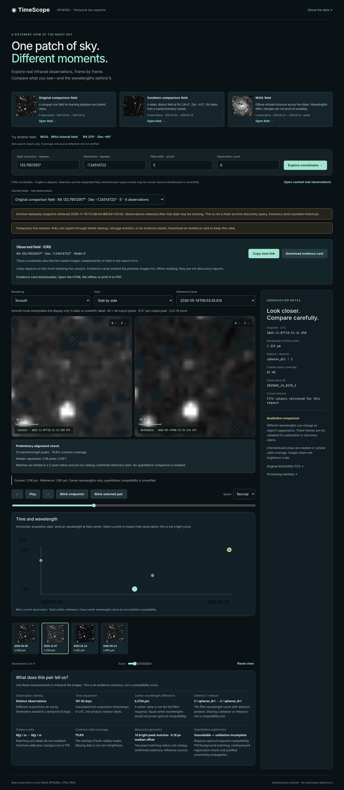
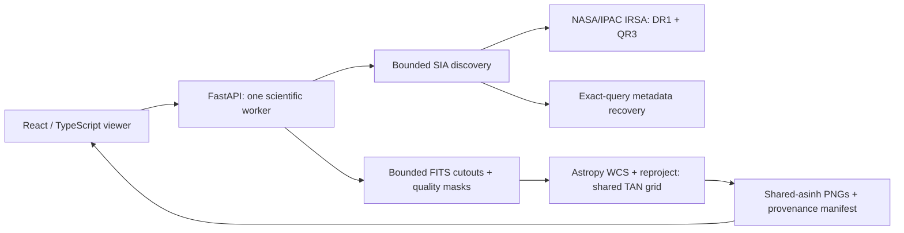

# TimeScope

Explore the same patch of sky through time using genuine NASA SPHEREx infrared observations. TimeScope turns celestial coordinates into an aligned, dated image sequence with comparison tools and downloadable evidence.

Built for NASA Space Apps 2026, **Planet X and SPHEREx**. Planet X motivates exploration; TimeScope does not claim a discovery or validated motion detection.

**[Open the application](https://timescope-331427520592.us-central1.run.app/)** · **[Independent real-data showcase](https://timescope-spherex.roanpaste16.chatgpt.site/)** · [Source](https://github.com/MohnishDhangar/TimeScope)



## Explore a field

1. Open a bundled real-data field, or enter ICRS right ascension and declination in decimal degrees.
2. Choose a 1–15 arcminute field and 2–12 requested observations. Live search depends on NASA/IPAC IRSA availability.
3. Step through the dated filmstrip, play the timeline or blink a selected pair. Compare frames side by side with synchronized zoom and pan.
4. Inspect acquisition times, wavelengths, coverage and original FITS provenance. Copy a view link or download an HTML evidence card with embedded previews.

| Bundled field | RA (degrees) | Dec (degrees) | Width | Real frames |
|---|---:|---:|---:|---:|
| Original comparison field | 133.79512917 | −7.24514722 | 5′ | 6 |
| Southern comparison field | 134.4 | −8.5 | 10′ | 6 |
| M101 | 210.80227 | +54.34895 | 6′ | 5 of 6 attempted |

The southern sequence uses a saved-inventory subset. M101 retains its partial-sequence disclosure. The original field does not establish a detection of WISE 0855. All 17 bundled previews are derived from real observations; synthetic fixtures are used only in software tests.

## Judging notes

The bundled showcase does not need live IRSA discovery. Live coordinate search and snapshot-backed cutout retrieval depend on the archive services being available. During November 15 testing, fresh IRSA searches intermittently returned HTTP 502; the underlying cause was not established.

When live discovery fails transiently, recovery tries a valid 24-hour runtime inventory, then an intentionally bundled historical inventory for the **exact same query**. Only the original field at 5′ currently has a bundled discovery inventory, retrieved **2026-11-15T12:28:44.186124+00:00**. Other declinations, including −2.24514722°, cannot reuse it. Historical metadata keep their original date and checksum and may omit later releases. This is not fresh discovery. FITS downloads and FITS-cache reuse are disclosed separately.

Search has bounded retries and one active scientific job. A Busy response preserves examples and offers retry. Live sessions and their links are temporary; download evidence to retain a readable record. The independent fallback offers bundled exploration, without arbitrary live search. Exact validation results and any remaining failures are in [the repair evidence](docs/discovery-repair-validation.json) and [current status](docs/FINAL-STATUS.md).

The competition tag `submission-v1` is planned but has **not** been created. This remains an incremental release; no official competition submission is claimed. The final competition version should remain unchanged during judging.

## Processing and architecture



The backend deduplicates by observation plus detector, preferring DR1, chooses one detector and samples distinct acquisition times. It masks unsuitable pixels and reprojects to a common north-up/east-left grid. Acquisition time uses DATE-OBS. Source URLs, SHA-256, cutout parameters, units, wavelength metadata, coverage, retrieval failures and processing choices accompany the previews. PNGs are visualization products, not calibrated scientific arrays.

One Cloud Run service serves the production Vite frontend and FastAPI from the same origin. It uses one worker, 1 CPU, 4 GiB, continuously allocated CPU, min/max one instance and a 512 MiB aggregate temporary-file limit. Runtime sessions expire or may disappear on replacement. [Deployment configuration and evidence](docs/CLOUD-DEPLOYMENT.md).

## Scientific limits

- SPHEREx's effective wavelength varies with detector position. The time-versus-wavelength chart is neither a spectrum nor a light curve. The current release does not select wavelength-matched frames.
- Wavelength, PSF, calibration and coverage differences can alter appearances. A shared intensity stretch does not establish photometric comparability.
- Bright-peak agreement checks are preliminary and are not independent catalog-validated astrometric accuracy. Coordinate reprojection alone does not establish measured alignment.
- Smooth rendering adds no resolution. Checkerboard areas show invalid or missing coverage. The conservative quality-mask policy still needs validation for moving/variable sources.
- The 1,000-record ceiling and incomplete or failed sequences are disclosed. Historical metadata do not guarantee that original files remain retrievable indefinitely.
- Difference imaging, catalog overlays, measured proper motions, source photometry and candidate detection are **not included in this deployed repair**. Separate unfinished wavelength work is preserved outside its release branch.

See [example validation](docs/example-validation.md), [comparison limitations](docs/comparison-validation.md), [archive probe](docs/discovery-probe.md) and [performance evidence](docs/performance.md). Historical test counts and earlier milestones are in [CHANGELOG](docs/CHANGELOG.md).

## Run and verify

Use the pinned environment and setup steps in [SETUP.md](SETUP.md). The existing tested interpreter is Python 3.14.7; the Docker image builds its frontend using Node 24.

```sh
python3 -m venv .venv
.venv/bin/python -m pip install -r requirements-resolved.txt
npm --prefix frontend ci
npm --prefix frontend run build
.venv/bin/python -m backend
```

Open http://localhost:8000. All three real examples are already bundled. Development checks:

```sh
.venv/bin/python -m pip install pytest
.venv/bin/python -m pytest -q
npm --prefix frontend run lint
npm --prefix frontend run build
cd frontend
npx playwright install chromium
npx playwright test --workers=1
```

Browser tests require the application running on port 8000. Synthetic retry tests mock clocks, sleep and failures; they do not issue archive requests. The real one-pass probe and public acceptance runs are reported separately. A successful health endpoint does not prove archive retrieval.

## Data, credit and AI assistance

The bundled examples use **SPHEREx DR1 and QR3 Spectral Images** from NASA/IPAC IRSA: [DR1, DOI 10.26131/IRSA678](https://doi.org/10.26131/IRSA678) and [QR3, DOI 10.26131/IRSA662](https://doi.org/10.26131/IRSA662). No all-sky cube is used. NASA funds SPHEREx, a joint project of JPL and Caltech. See the [official release acknowledgements](https://irsa.ipac.caltech.edu/data/SPHEREx/docs/overview_dr1.html), [IRSA tutorials](https://caltech-ipac.github.io/irsa-tutorials/spherex-cutouts/) and [third-party credits](THIRD_PARTY.md).

AI tools assisted planning, implementation, debugging, documentation and test design. AI output is not evidence of scientific validity; the reproducible checks and actual observation provenance are recorded separately. The project owner confirmed that no earlier project code was reused. Final submission disclosure should identify all tools actually used.

Original TimeScope source is [MIT licensed](LICENSE), approved by the project owner. Scientific data and third-party dependencies retain their own terms and acknowledgements.
