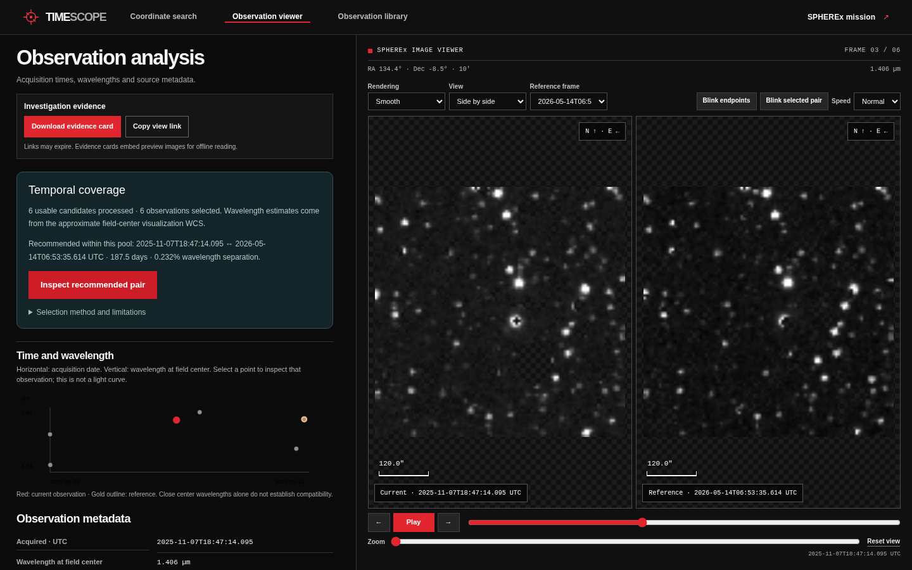
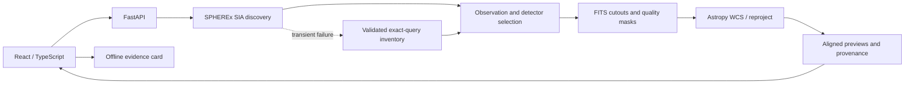

# TimeScope

**Multi-epoch infrared astronomy with NASA SPHEREx**

TimeScope is a public scientific web application for exploring the same sky region across observation dates. It retrieves SPHEREx spectral images, aligns them on a common celestial coordinate grid, and provides playback, paired comparison, wavelength-aware observation selection and reproducible evidence export.

Built for the **2026 NASA Space Apps Challenge — Planet X and SPHEREx**.

[Live application](https://timescope-331427520592.us-central1.run.app/) · [Independent real-data showcase](https://timescope-spherex.roanpaste16.chatgpt.site/) · [Challenge](https://hackathlone.com/challenges/planet-x-and-spherex)



## Scientific workflow

1. Enter right ascension and declination (ICRS, decimal degrees), a field width of 1–15 arcminutes and a requested count of 2–12 observations. Alternatively, select a challenge-target preset or open a bundled sequence.
2. Search SPHEREx DR1 and QR3 using bounded SIA discovery. Select a detector or use automatic selection; choose chronological or wavelength-prioritized observation selection.
3. Play the aligned observations, select a date on the timeline, blink a pair or compare two images side by side with synchronized pan and zoom.
4. Inspect acquisition times, center wavelengths, detector, collection, coverage, pairwise alignment diagnostics and original FITS provenance.
5. Copy a shareable view link or download a standalone HTML evidence card with embedded image previews and scientific limitations.

The fixed image viewer and adjacent analysis panel keep the images, observation graph and metadata in the same investigation workspace.

## Real-data results

The current repository includes **seven bundled fields with 33 usable SPHEREx observation frames**, including reference fields for all five targets named in the challenge.

| Field | RA (°) | Dec (°) | Width (arcmin) | Usable frames |
|---|---:|---:|---:|---:|
| WISE 0855 reference field | 133.79512917 | −7.24514722 | 5 | 6 |
| Barnard's Star reference field | 269.45210 | +4.69340 | 6 | 6 |
| Epsilon Indi B reference field | 331.04570833 | −56.78344444 | 5 | 4 of 6 |
| RW Aurigae reference field | 76.95652603 | +30.40143817 | 5 | 2 of 4 |
| R Draconis reference field | 248.16761083 | +66.75497942 | 5 | 4 |
| Southern comparison field | 134.4 | −8.5 | 10 | 6 |
| M101 | 210.80227 | +54.34895 | 6 | 5 of 6 |

These counts refer to the packaged sequences, not all observations available from the archive. The WISE reference-field acceptance test separately processed four frames using historical discovery metadata. The southern field uses a saved-inventory subset; Epsilon Indi B, RW Aurigae and M101 are partial sequences.

All five named reference-field tests produced usable multi-epoch sequences. **This does not establish identification, motion or variability of the named objects.** In particular, Barnard's Star's bundled sequence uses its reference position without epoch propagation; the contemporary source may be outside that 6′ field. The Barnard preset offers a 10′ search width. Epsilon Indi B uses the brown-dwarf system position, not the primary star.

[Target validation and coordinate references](docs/challenge-target-validation.md) · [Machine-readable target evidence](docs/challenge-target-validation.json) · [Challenge compliance](docs/challenge-compliance.md)

A separate fresh public search at RA 133.79512917°, Dec −2.24514722°, width 5′ returned 290 records and produced six fresh FITS frames without historical inventory substitution. See the [acceptance report](docs/final-acceptance.md). This demonstrates live operation for that query, not continuous archive availability.

## Architecture



- **Frontend:** React, TypeScript and Vite; image playback, comparison, metadata and evidence export.
- **Backend:** FastAPI, Astroquery, Astropy, Reproject, NumPy and SciPy.
- **Discovery:** bounded SIA requests, transient retries, observation-plus-detector deduplication, and explicitly disclosed historical metadata recovery.
- **Processing:** DATE-OBS acquisition times, FITS quality masks, common north-up/east-left TAN grid, shared asinh display scale and per-observation provenance.
- **Deployment:** Google Cloud Run, with one scientific worker, bounded runtime storage and admission limits.

The pipeline preserves original FITS URLs, SHA-256 checksums, cutout parameters, collection, detector, units, wavelengths, coverage and retrieval outcomes. Rendered PNG previews are visualization products, not calibrated scientific arrays.

## Archive availability and scientific limitations

Live searches depend on the NASA/IPAC archive. Direct SIA discovery has succeeded despite intermittent HTTP 502 responses and timeouts on archive access routes. If discovery fails, TimeScope may reuse a validated inventory for the exact query, with its original date and scope disclosed. This is not fresh discovery. FITS retrieval, cached FITS reuse and completed-session reuse are distinguished.

Bundled observations remain usable without fresh archive discovery. Live sessions are temporary; evidence cards preserve the selected images and metadata for offline review. The independent static showcase is a separate, earlier bundled-data release and does not support arbitrary live searches.

SPHEREx's wavelength varies with detector position. Wavelength-prioritized selection ranks approximate center-wavelength separation; it does not establish identical spectral response. Different wavelengths, PSFs, calibration, noise and coverage can alter image appearance. The time–wavelength graph is neither a spectrum nor a light curve. Bright-peak alignment diagnostics are preliminary, not catalog-validated precision astrometry. Smooth display interpolation adds no resolution.

No discovery of Planet X, confirmed source detection, measured proper motion, calibrated photometry, validated difference imaging or automated candidate detection is claimed. The all-sky spectral cube and external catalog overlays are not part of the verified repository release described here.

[Scientific comparison methodology](docs/comparison-validation.md) · [Wavelength validation](docs/wavelength-validation.md) · [Archive recovery](docs/discovery-recovery.md)

## Run locally

Use the pinned environment described in [SETUP.md](SETUP.md). The tested Python version is 3.14.7; the production container builds the frontend with Node 24.

```bash
python3 -m venv .venv
.venv/bin/python -m pip install -r requirements-resolved.txt
npm --prefix frontend ci
npm --prefix frontend run build
.venv/bin/python -m backend
```

Open http://localhost:8000. The backend serves the frontend and API from the same origin. Bundled data are included in the repository.

## Tests and release evidence

```bash
.venv/bin/python -m pip install pytest
.venv/bin/python -m pytest -q
npm --prefix frontend run lint
npm --prefix frontend run build
cd frontend
npx playwright install chromium
npx playwright test --workers=1
```

Run the application on port 8000 before the browser suite.

The seven-field source candidate at commit `81a7275` recorded 122 passing backend tests and 31 frontend checks (30 Chromium scenarios and one metadata-logic check); production build and lint passed. See the [final test report](docs/final-test-report.md). Synthetic fixtures are used for software verification, not as astronomical evidence.

The latest **recorded** Cloud Run deployment is revision `timescope-00006-rzk`, built from `92dbf60` with five bundled fields and 23 frames. The subsequent seven-field update is present in source; consult the [deployment record](docs/cloud-deployment-record.json) for the exact deployed version rather than assuming every repository update is already live. [Cloud deployment guide](docs/CLOUD-DEPLOYMENT.md).

## Data, credits and license

- NASA/IPAC IRSA SPHEREx DR1 Spectral Images — [DOI 10.26131/IRSA678](https://doi.org/10.26131/IRSA678).
- NASA/IPAC IRSA SPHEREx QR3 Spectral Images — [DOI 10.26131/IRSA662](https://doi.org/10.26131/IRSA662).
- [SPHEREx release documentation](https://irsa.ipac.caltech.edu/data/SPHEREx/docs/overview_dr1.html) and [IRSA cutout tutorial](https://caltech-ipac.github.io/irsa-tutorials/spherex-cutouts/).
- [Third-party software, data acknowledgments and licenses](THIRD_PARTY.md).

TimeScope acknowledges NASA funding, the joint JPL/Caltech SPHEREx mission, NASA/IPAC IRSA and the instrument, calibration and archive teams. NASA affiliation or endorsement is not implied.

**Development disclosure:** OpenAI ChatGPT and Codex assisted planning, implementation, debugging, documentation and test design. Scientific claims are supported by the recorded observations and validation evidence, not by generated text. The project owner confirmed that no earlier personal-project code was reused.

Original TimeScope source is available under the [MIT license](LICENSE). Scientific data and third-party software retain their own terms.
